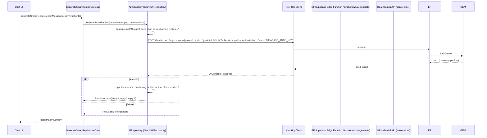

# AI Architecture

AI component architecture and the smart-reply request/response flow.

## Component architecture

```mermaid
flowchart TD
    subgraph UI["Presentation"]
        UI[Chat screen · reply suggestions chip]
    end

    subgraph Domain["Domain (framework-free)"]
        USECASE[GenerateSmartRepliesUseCase]
        REPO[AiRepository interface]
    end

    subgraph Data["Data layer"]
        GEMINI[GeminiAiRepository]
        HTTP[Ktor HttpClient]
        TELEM[AiTelemetry · platform]
    end

    subgraph Server["Supabase Edge Function"]
        EF[/functions/v1/ai-generate · gemini-1.5-flash]
    end

    UI --> USECASE
    USECASE --> REPO
    REPO --> GEMINI
    GEMINI --> HTTP
    HTTP --> EF
    GEMINI --> TELEM

    style Server fill:#ffebee,stroke:#c62828
    style Data fill:#e8f5e9,stroke:#2e7d32
```

## Smart replies flow



## Request/response format

**Request** (to Supabase Edge Function):
```json
{ "prompt": "...", "model": "gemini-1.5-flash" }
```

**Response**:
```json
{ "text": "Reply one\nReply two\nReply three", "error": null }
```

## Configuration notes

- `SynapseConfig` defines endpoints for Gemini, OpenAI, Anthropic, OpenRouter, ImgBB, Cloudinary, but the **implemented** AI path only calls the Supabase Edge Function (`ai-generate`) with the Gemini model.
- The other endpoints and keys are configured but not wired to an active implementation.
