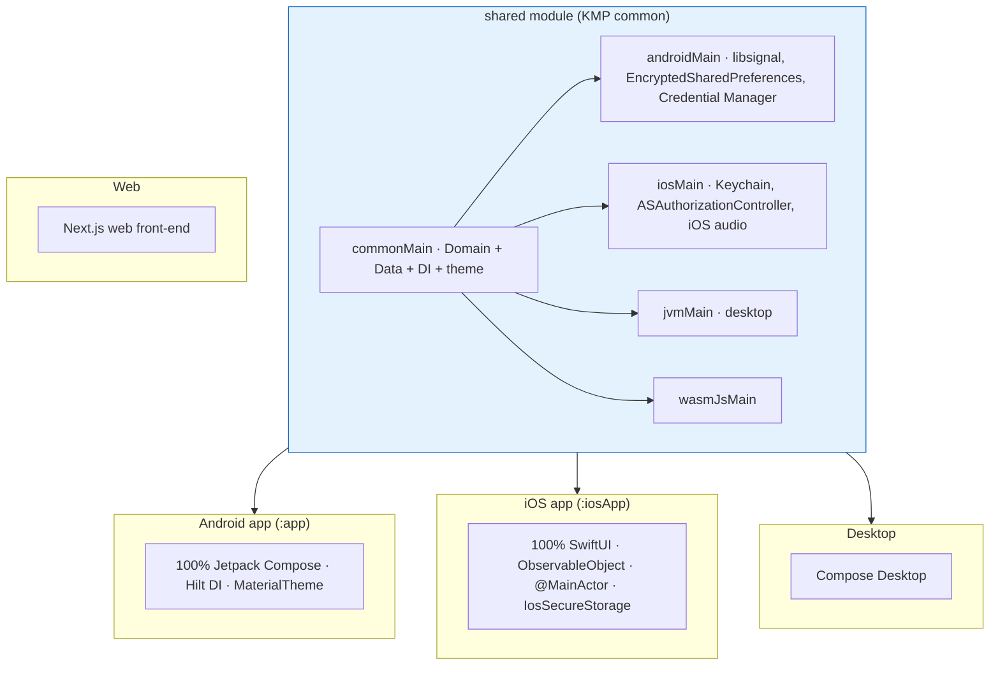

# Architecture

Synapse Social's overall architecture: Clean Architecture + MVVM on Kotlin Multiplatform, module boundaries, and dependency injection.

## Architecture document index

| Document | Path | Contents |
|----------|------|----------|
| Project structure | `./project-structure.md` | KMP module layout, source sets, platform apps. |
| Dependency injection | `./dependency-injection.md` | Koin DI modules, expect/actual platform wiring. |

## Architecture overview

Synapse follows **Clean Architecture + MVVM** with a strict layering rule:

```
Presentation  →  ViewModel  →  Domain (UseCases / Interfaces)  →  Data (Repos / DTOs / Mappers)
```

### Layering rules

| Layer | May depend on | Must not |
|-------|---------------|----------|
| **Presentation** (UI + ViewModel) | Domain UseCases, domain models | Backend SDKs, Supabase types, platform APIs directly |
| **Domain** (UseCases, repository interfaces, models) | Nothing external (framework-free) | Any framework, SDK, or platform (no `android.*`, `java.*` in `shared/commonMain`) |
| **Data** (repositories, data sources, DTOs, mappers) | Domain interfaces + external SDKs | Leaking DTOs to Domain/UI (mappers mandatory) |

- **Domain has zero knowledge of any framework, SDK, or platform.**
- **Data owns all external concerns:** network, storage, SDKs (Supabase, libsignal, Ktor, SQLDelight).
- **Presentation is dumb:** it renders state and forwards events only.
- **UseCases always return `Result<T>` or a sealed `Either` — never raw exceptions.**
- One `operator fun invoke()` per UseCase; no constructor logic.
- Mappers are mandatory: DTOs never reach Domain or UI.

## KMP structure at a glance



## Dependency injection

DI is split between the shared module (Koin) and platform apps:

- **Shared:** Koin modules (`PasskeyModule`, `SecureStorageModule`, `StorageModule`, `AiModule`, `SyncModule`, `DeviceModule`, `PresenceModule`, `CommentModule`) with `expect`/`actual` platform modules for `SecureStorage`, `PasskeyPlatformManager`, storage driver, and file uploader.
- **Android (`:app`):** Hilt.
- **Exposed to iOS:** via `DependencyContainer`.

Platform apps (Android `:app`, iOS `:iosApp`, web) consume feature UseCases or domain interfaces exclusively — direct backend SDK calls in UI/ViewModels are prohibited.

## Trust boundaries

- **Client-trusted:** UI, ViewModel, UseCases, crypto (`SignalProtocolManager`, `AndroidSignalStore`), local DB (SQLDelight), secure storage. Plaintext and private keys exist only here.
- **Server-untrusted:** Supabase (PostgREST, Realtime, Storage, Auth). Stores ciphertext and public keys only; never plaintext or private keys.

## Cross-cutting concerns

| Concern | Implementation |
|---------|----------------|
| Logging | `Logger` (shared util) / `Napier` |
| Dispatchers | `AppDispatchers` (platform IO/Main dispatchers) |
| Time | `TimeProvider` |
| UUIDs | `UUIDUtils` |
| Encrypted strings | `EncryptedStringAdapter` (SQLDelight custom adapter for `User.email`) |
| Errors | `Result<T>` in UseCases/repositories; `AuthError` for auth |

## Related feature documentation

- [E2EE](../E2EE/README.md)
- [Authentication](../Authentication/README.md)
- [Chat](../Chat/README.md)
- [Database](../Database/README.md)
- [AI](../AI/README.md)
- [Voice](../Voice/README.md)
- [Groups](../Groups/README.md)
- [Notifications](../Notifications/README.md)
