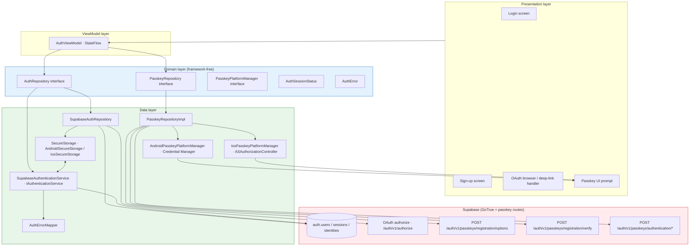
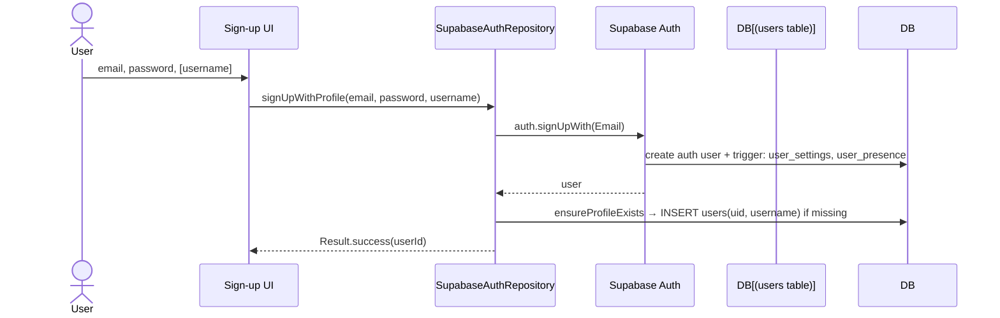
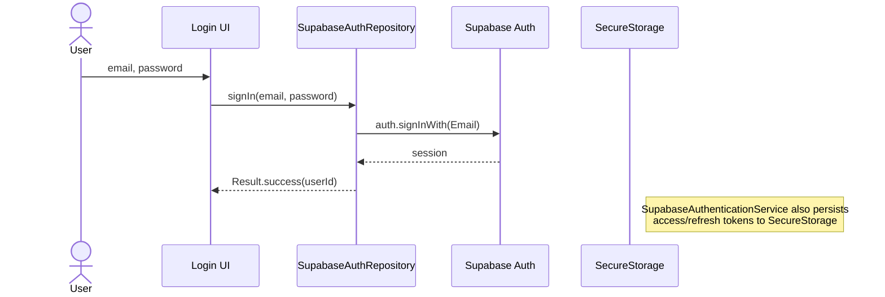
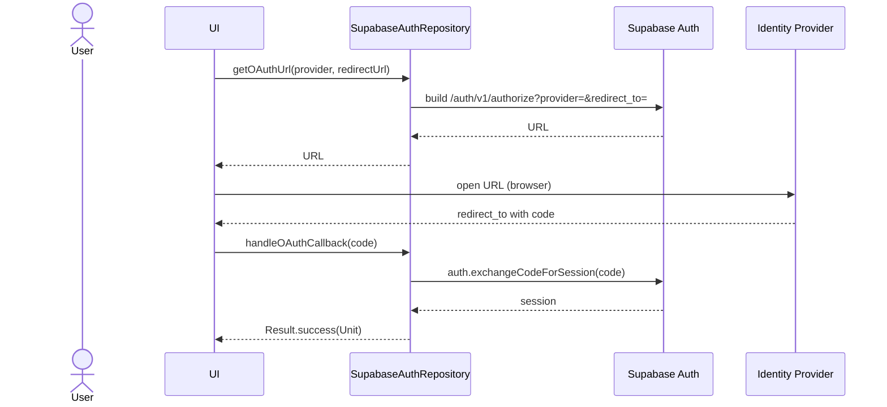
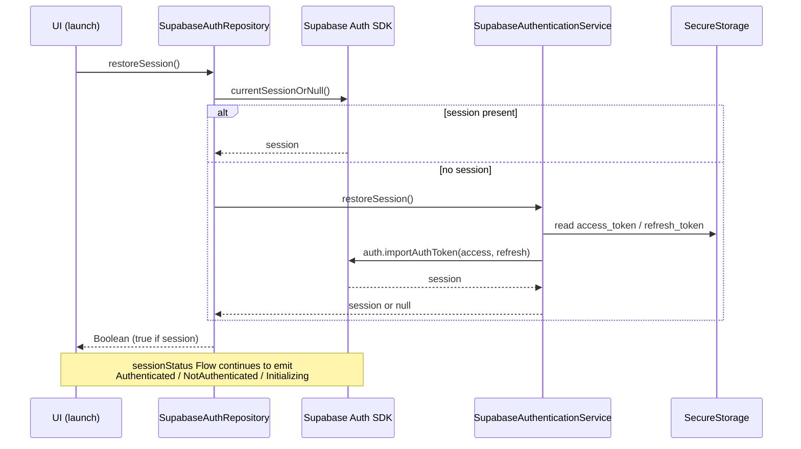

# Authentication Architecture

Detailed component architecture for authentication and session management, including Mermaid diagrams for the sign-up, sign-in, OAuth, and passkey flows.

## Component architecture

## UseCase inventory (auth)

| UseCase | Purpose |
|---------|---------|
| `SignInWithPasskeyUseCase` | Passkey discoverable-credential sign-in: options → platform assert → verify → session import. |
| `AddPasskeyUseCase` | Register a new passkey for the signed-in user. |
| `LoadPasskeysUseCase` | List the user's registered passkeys. |
| `RemovePasskeyUseCase` | Revoke a passkey by id. |

All auth UseCases return `Result<T>`.

## Koin DI wiring (auth)

- `passkeyModule` (`di/PasskeyModule.kt`): declares `expect val passkeyPlatformModule: Module` (platform-specific, registers `PasskeyPlatformManager`), binds `PasskeyRepository` → `PasskeyRepositoryImpl(SupabaseClient.client)`, and the passkey UseCases.
- `secureStorageModule` (`di/SecureStorageModule.kt`): `expect val secureStorageModule: Module` — platform implementations register `SecureStorage` (Android `AndroidSecureStorage`, iOS `IosSecureStorage`).
- `SupabaseClient.client` is a lazy singleton in `core/network/SupabaseClient.kt`, injected into repository implementations.

## Flows

### Sign-up (email/password)

### Sign-in (email/password)

### OAuth (Google, Apple, GitHub, …)

### Session restore (app launch)

## Sign-out

1. `AuthRepository.signOut()` → `SupabaseAuthRepository.signOut()`.
2. `AccountSyncManager.clearAllLocalData(...)` clears messages, conversations, posts, stories, offline actions, sync state.
3. Best-effort `client.auth.signOut()` (10s timeout); network failure does not block sign-out.
4. `client.auth.clearSession()` clears the locally persisted SDK session.

## Security considerations

- Tokens persisted to `SecureStorage`; no-op with warning when storage unavailable.
- OAuth redirect URLs allowlisted (`synapse://login`, `socialsynapse.vercel.app`, `synapsesocial.vercel.app`, `www.synapse.com/auth`).
- `isConfigured()` guard prevents OAuth with placeholder credentials.
- Sign-out clears local data before remote revocation to avoid transient data exposure.
- Two auth implementations coexist (`SupabaseAuthRepository` for the domain `AuthRepository` contract, `SupabaseAuthenticationService` for lower-level token storage); domain code uses `AuthRepository` only.
