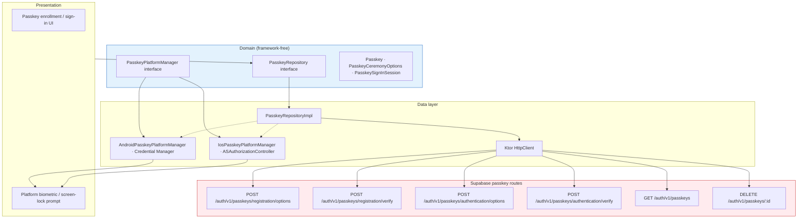
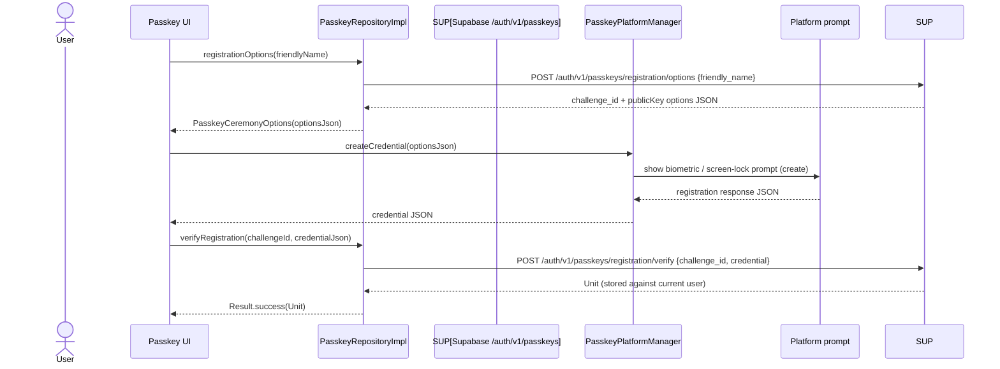
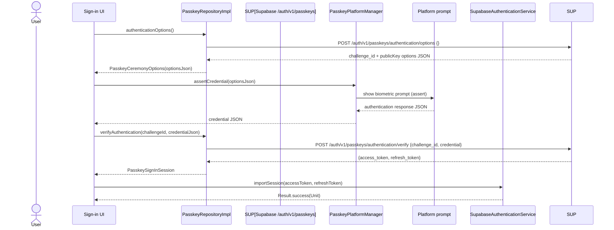

# Passkeys (WebAuthn)

Passkey (WebAuthn) registration and passwordless sign-in in Synapse Social. The domain contract is backend-neutral; the concrete backend is Supabase's native passkey routes (`/auth/v1/passkeys/*`) called over a Ktor HTTP client, and platform ceremonies are handled by Android Credential Manager or iOS `ASAuthorizationController`.

## Passkey document context

- Entry point: [`./README.md`](./README.md)
- Related: [`./architecture.md`](./architecture.md) (auth architecture & DI)
- E2EE dependency: none — passkeys are an authentication mechanism, not an encryption key source.

## Component architecture



## Domain interfaces

### `PasskeyRepository`

| Method | Purpose |
|--------|---------|
| `registrationOptions(friendlyName)` | Fetch WebAuthn creation options (challenge) for enrolling a passkey for the signed-in user. |
| `verifyRegistration(challengeId, credentialJson)` | Validate the registration credential response and store it against the current user. |
| `authenticationOptions()` | Fetch WebAuthn request options for a discoverable-credential sign-in. |
| `verifyAuthentication(challengeId, credentialJson)` | Validate the authentication credential response and return a `PasskeySignInSession` (tokens). |
| `listPasskeys()` | List the user's registered passkeys. |
| `deletePasskey(id)` | Revoke a passkey. |

All methods return `Result<T>`. The acting user is derived from the current Supabase session; no user ID is threaded through.

### `PasskeyPlatformManager`

| Member | Purpose |
|--------|---------|
| `isSupported` | Whether the platform can create/use passkeys (Android: `SDK_INT >= P`). |
| `createCredential(requestJson)` | Create a resident passkey credential (Jetpack Credential Manager on Android). |
| `assertCredential(optionsJson)` | Perform a passkey assertion (biometric sign-in). |

Platform implementations are injected via Koin (`passkeyPlatformModule`, expect/actual).

## Protocol flow

### Registration (enrollment)



### Authentication (sign-in)



### Platform ceremony notes

- **Android** (`AndroidPasskeyPlatformManager`): uses Jetpack `CredentialManager` (`CreatePublicKeyCredentialRequest` / `GetPublicKeyCredentialOption`). `isSupported` = `SDK_INT >= Build.VERSION_CODES.P` (note: Credential Manager is actually API 28+, but the code checks `P` = 28). Ceremonies require a foreground `Activity`; a missing activity throws `IllegalStateException("No screen is open to show the passkey prompt")`.
- **iOS** (`IosPasskeyPlatformManager`): platform implementation via `ASAuthorizationController` (see `shared/src/iosMain/.../data/passkey/IosPasskeyPlatformManager.kt`).

## Backend contract (Supabase passkey routes)

All requests include headers `apikey: SUPABASE_ANON_KEY` and, when authenticated, `Authorization: Bearer <access_token>`. Responses are leniently parsed:

| Route | Method | Auth | Purpose |
|-------|--------|------|---------|
| `/auth/v1/passkeys/registration/options` | POST | yes | Returns challenge + WebAuthn creation options. |
| `/auth/v1/passkeys/registration/verify` | POST | yes | Validates registration credential; stores credential against current user. |
| `/auth/v1/passkeys/authentication/options` | POST | no | Returns challenge + WebAuthn request options for sign-in. |
| `/auth/v1/passkeys/authentication/verify` | POST | no | Validates assertion; returns `access_token` / `refresh_token`. |
| `/auth/v1/passkeys` | GET | yes | List passkeys for current user. |
| `/auth/v1/passkeys/:id` | DELETE | yes | Revoke a passkey. |

Response parsing is tolerant of varying key names:
- Challenge id: `challenge_id`, `challengeId`, or `id`.
- Options object: `options`, `publicKey`, `creationOptions`, or `requestOptions`; a nested `publicKey` wrapper is unwrapped.
- Error keys: `msg`, `error_description`, `error`, `message`, `code`.

> **Note:** The supabase-kt SDK (3.8.0) has no passkey API, so `PasskeyRepositoryImpl` issues these requests directly via Ktor. All Supabase-specific detail (paths, headers, JSON shapes) is encapsulated here; domain and presentation layers are provider-neutral.

## Koin DI

`di/PasskeyModule.kt`:
```kotlin
expect val passkeyPlatformModule: Module   // platform registers PasskeyPlatformManager

val passkeyModule = module {
    includes(passkeyPlatformModule)
    single<PasskeyRepository> { PasskeyRepositoryImpl(SupabaseClient.client) }
    single { LoadPasskeysUseCase(get()) }
    single { RemovePasskeyUseCase(get()) }
    single { AddPasskeyUseCase(get(), get()) }
    single { SignInWithPasskeyUseCase(get(), get(), get()) }
}
```

Platform modules:
- Android: `di/PasskeyPlatformModule.android.kt` → `AndroidPasskeyPlatformManager(PasskeyActivityProvider)`.
- iOS: `di/PasskeyPlatformModule.ios.kt` → `IosPasskeyPlatformManager`.

## Security considerations

- **Passkeys are an authentication factor, not an E2EE key source.** The private passkey credential never encrypts chat messages; E2EE uses the separate Signal Protocol identity/pre-keys (`docs/E2EE`).
- Ceremonies require a real device/biometric prompt and cannot be automated on headless environments.
- Passkey verification responses are parsed leniently; backend field-name drift is absorbed in `PasskeyRepositoryImpl` only.
- Sign-in via passkey imports a Supabase session (`importAuthToken`), so passkey and password auth share the same session model.
