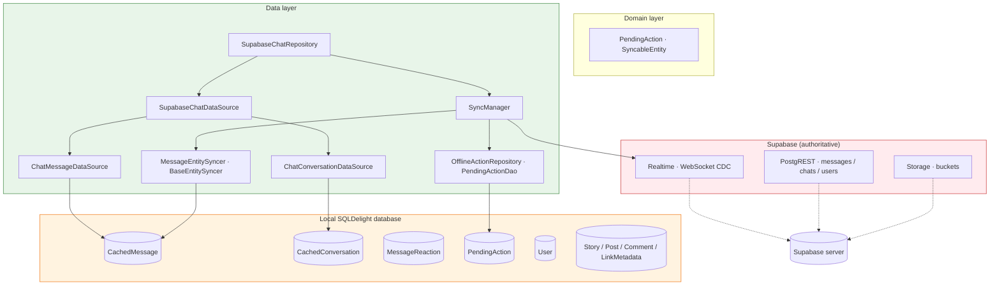

# Database

Local persistence and synchronization architecture in Synapse Social. The app uses **SQLDelight** for the local relational database and **Supabase** as the authoritative remote store, coordinated by `SyncManager` with an offline action queue.

## Database document index

| Document | Path | Contents |
|----------|------|----------|
| Architecture | `./architecture.md` | Database architecture, schema, sync flow, Mermaid diagrams. |
| Caching | `./caching.md` | Message/conversation caching, cache-first reads, decryption cache, cache bounds. |

## Technology overview

| Component | Technology | Responsibility |
|-----------|------------|----------------|
| Local DB | SQLDelight (KMP) | Relational local storage with type-safe generated DAOs. |
| Schema | `.sq` table definitions + `.sqm` migrations | `CachedMessage`, `CachedConversation`, `User`, `MessageReaction`, `Story`, `Post`, `Comment`, `PendingAction`, `StorageConfig`, `LinkMetadata`. |
| Remote | Supabase PostgREST + Storage | Authoritative source for all shared data. |
| Realtime | Supabase Realtime (WebSocket) | CDC-driven live updates pushed to local cache. |
| Sync coordinator | `SyncManager` | Per-entity sync state, push-then-pull, reconnect/backoff, logout clearing. |
| Message syncer | `MessageEntitySyncer` | `BaseEntitySyncer` for `messages`; Supabase authoritative, local soft-deletes. |
| Offline queue | `OfflineActionRepository` + `PendingAction` table | Pending local changes (send/edit/delete message) retried on reconnect (max 3 attempts). |
| DAOs | `SqlDelight*Dao` implementations | Generated DAOs for `CachedMessage`, `CachedConversation`, `MessageReaction`, `PendingAction`, `Story`, etc. |

## Important source-code references

- `shared/src/commonMain/sqldelight/com/synapse/social/studioasinc/shared/data/database/` — SQLDelight schema (`.sq`) and migrations (1.sqm–7.sqm).
- `shared/src/commonMain/kotlin/com/synapse/social/studioasinc/shared/data/local/database/CachedMessageDao.kt` — `CachedMessageDao` interface.
- `shared/src/commonMain/kotlin/com/synapse/social/studioasinc/shared/data/local/database/SqlDelightCachedMessageDao.kt` — SQLDelight `CachedMessage` DAO.
- `shared/src/commonMain/kotlin/com/synapse/social/studioasinc/shared/data/local/database/CachedConversationDao.kt` — `CachedConversationDao` interface.
- `shared/src/commonMain/kotlin/com/synapse/social/studioasinc/shared/data/local/database/SqlDelightCachedConversationDao.kt` — SQLDelight `CachedConversation` DAO.
- `shared/src/commonMain/kotlin/com/synapse/social/studioasinc/shared/data/local/database/MessageReactionDao.kt` / `SqlDelightMessageReactionDao.kt` — reaction DAO.
- `shared/src/commonMain/kotlin/com/synapse/social/studioasinc/shared/data/local/database/PendingActionDao.kt` / `SqlDelightPendingActionDao.kt` — offline action DAO.
- `shared/src/commonMain/kotlin/com/synapse/social/studioasinc/shared/data/sync/SyncManager.kt` — sync coordinator.
- `shared/src/commonMain/kotlin/com/synapse/social/studioasinc/shared/data/sync/MessageEntitySyncer.kt` — message entity syncer.
- `shared/src/commonMain/kotlin/com/synapse/social/studioasinc/shared/data/sync/SyncModels.kt` — `SyncableEntity`, `SyncResult`, `SyncState`.
- `shared/src/commonMain/kotlin/com/synapse/social/studioasinc/shared/data/sync/MessageEntitySyncerFactory.kt` — syncer factory.
- `shared/src/commonMain/kotlin/com/synapse/social/studioasinc/shared/domain/model/PendingAction.kt` — offline action model.
- `shared/src/commonMain/kotlin/com/synapse/social/studioasinc/shared/data/sync/AccountSyncManager.kt` — clears local data on sign-out/account switch.
- `shared/src/commonMain/kotlin/com/synapse/social/studioasinc/shared/di/StorageModule.kt` — Koin DI for database, DAOs, media upload services.
- `shared/src/commonMain/kotlin/com/synapse/social/studioasinc/shared/di/SyncModule.kt` — Koin DI for sync.

## Related feature documentation

- [Chat](../Chat/README.md) — messages/conversations cached here.
- [E2EE](../E2EE/README.md) — decrypted-message cache (`CachedMessage.content`) used by `ChatEncryptionHelper`.
- [Authentication](../Authentication/README.md) — sign-out clears all local data.

## Database architecture

## Sync model

SyncManager follows a **push-then-pull** pattern per entity type:

1. **Push:** pending local actions for the entity type (from `OfflineActionRepository`) are applied to Supabase. Success → remove action; failure → increment `retryCount`, max 3 retries then emit `PendingActionFailed`.
2. **Pull:** fetch remote changes since `lastSyncedAt` via the entity syncer's `pullFromRemote(sinceMs)`.
3. **Realtime:** `subscribeRealtime(entityType, tableName)` subscribes to Supabase Postgres CDC; insert/update/delete records are dispatched to the syncer (`handleRemoteInsert/Update/Delete`).
4. **Reconnect:** on channel loss, reconnect after 5s; on network reconnect, resync all entity types.

For messages specifically, `MessageEntitySyncer.fetchFromRemote` returns empty (messages are fetched per-chat by `SupabaseChatRepository`); Realtime handles live inserts, and `saveLocal` upserts into `CachedMessage`.

> Supabase is authoritative: remote wins unless the local copy has an unsynced pending change. Deleted records are soft-deleted locally (`is_locally_deleted`, `is_deleted`) so they never reappear from stale cache.

## Migrations

| Migration | Change |
|-----------|--------|
| 1.sqm | `ALTER TABLE User ADD COLUMN email` |
| 2.sqm – 6.sqm | (additive column/table changes) |
| 7.sqm | `ALTER TABLE CachedMessage ADD COLUMN metadata` |

Newer sync columns (`updated_at`, `is_locally_deleted`, `last_synced_at`, `sync_version`) are present on `CachedMessage` and `User`.

## Key tables

### CachedMessage

| Column | Purpose |
|--------|---------|
| `id` (PK) | Message ID. |
| `chat_id`, `sender_id` | Conversation and sender. |
| `content` | Plaintext (decrypted) or placeholder. |
| `delivery_status` | SENDING / SENT / DELIVERED / READ / FAILED. |
| `content_status` | ACTIVE / EDITED / DELETED. |
| `read_by`, `read_at` | Read receipts. |
| `created_at`, `sent_at`, `delivered_at`, `edited_at`, `deleted_at`, `expires_at` | Timestamps. |
| `reply_to_id`, `media_url`, `metadata` | Rich message fields. |
| `is_deleted`, `is_edited`, `is_locally_deleted` | Soft-delete flags. |
| `cached_at`, `updated_at`, `last_synced_at`, `sync_version` | Sync metadata. |

Queries: `upsertMessage`, cursor-based `selectActiveByChatIdBefore/After`, `markDeleted`, `updateContent`, `deleteExpired`, `selectForSync`, `selectPendingMessages`.

### CachedConversation

| Column | Purpose |
|--------|---------|
| `chat_id` (PK) | Conversation ID. |
| `participant_id`, `participant_name`, `participant_avatar` | Participant info. |
| `last_message`, `last_message_time` | Inbox preview. |
| `unread_count`, `is_online`, `is_group` | Inbox state. |
| `cached_at` | Cache timestamp. |

### User

Email stored as `EncryptedString` (custom adapter). Sync columns present.

### MessageReaction

Composite PK (`message_id`, `user_id`, `reaction_emoji`), `timestamp`.

### PendingAction

Offline queue: `id`, `actionType` (SEND_MESSAGE, EDIT, DELETE, ...), `targetId`, `payload`, `retryCount`, `localVersion`.
