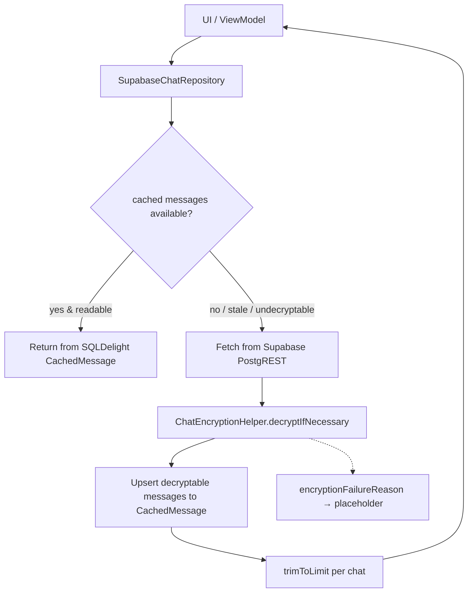
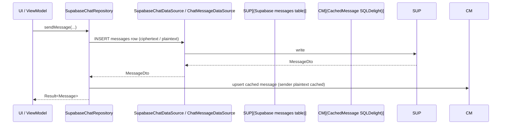
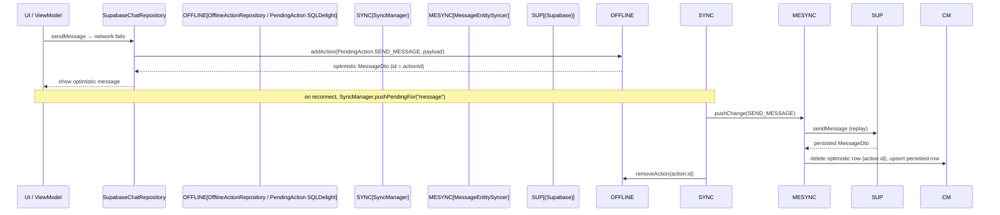

# Database Architecture

Detailed local database schema, sync architecture, and offline behavior.

## Schema overview

SQLDelight source: `shared/src/commonMain/sqldelight/com/synapse/social/studioasinc/shared/data/database/`

| Table file | Description |
|------------|-------------|
| `CachedMessage.sq` | Cached chat messages (primary message cache). |
| `CachedConversation.sq` | Inbox conversation summaries. |
| `User.sq` | User profiles (email as `EncryptedString`). |
| `MessageReaction.sq` | Message reactions (composite PK). |
| `Story.sq`, `Post.sq`, `Comment.sq`, `LinkMetadata.sq` | Feed content. |
| `StorageConfig.sq` | Persisted storage provider config. |
| `PendingAction.sq` | Offline action queue. |

Migrations: `1.sqm`–`7.sqm` (additive `ALTER TABLE` changes).

## Data flow: read path

## Data flow: write path (send message, online)

## Data flow: write path (offline)

## Cache-first reads

`getMessagesCacheFirst(chatId, limit, refreshInBackground, before, beforeId)`:
1. Cursor-based read from `CachedMessage` (`selectActiveByChatIdBefore/After`, excluding `is_locally_deleted`).
2. Filter out user-deleted IDs (`getUserDeletedMessageIds`).
3. If `refreshInBackground` and cache not fresh (`isCacheFresh` 30s window), launch background sync.
4. Return cached visible messages immediately (never block on network).

`getMessages`:
1. Cache-first for `before == null && !forceNetwork`.
2. If cache empty → network fetch, decrypt, upsert, trim.
3. Errors fall back to cache if available.

## Cache bounds & cleanup

- `trimToLimit(chatId, limit)` (`deleteOldestBeyondLimit`) keeps only the latest `limit` messages per chat in `CachedMessage`.
- `markLocallyDeleted` / `markMultipleLocallyDeleted` soft-delete rows so stale-cache reappearance is prevented on account switch.
- `deleteAllByChatId` and `AccountSyncManager.clearAllLocalData` clear tables on logout/account switch.
- `deleteExpired` removes disappearing messages where `expires_at < now`.

## Decryption cache (E2EE)

`ChatEncryptionHelper` maintains:
1. **In-memory** `decryptedMessageCache: MutableMap<String, String>` (per-sender `Mutex`).
2. **SQLDelight** `CachedMessage.content` — plaintext written back via `updateContent(messageId, content)` after successful decryption.

Decrypted plaintext is what is cached; raw ciphertext is never stored as readable content. See [`../E2EE/message-encryption.md`](../E2EE/message-encryption.md).

## Sync state

- `SyncState` per entity type: `isSyncing`, `lastSyncedAt`, `pendingCount`, `lastError`.
- `SyncEvent` sealed class: `SyncCompleted`, `SyncFailed`, `RemoteInsert/Update/Delete`, `PendingActionCompleted/Failed`, `NetworkReconnected/Disconnected`, `DataCleared`.
- Persisted via `SyncStateStorage` (currently `InMemorySyncStateStorage` — in-memory only; not persisted across process death).

> **Limitation:** `InMemorySyncStateStorage` is in-memory; sync state and last-synced timestamps are lost on process death, causing full re-sync on next launch.

## Offline behavior

- Writes while offline are queued as `PendingAction` and retried on reconnect (max 3 attempts).
- Reads fall back to the local SQLDelight cache.
- Message sends show optimistically (action ID as message ID) and are replaced with the persisted row on successful sync to avoid duplicates.
- `AccountSyncManager.clearAllLocalData` clears all tables + pending actions + sync state on sign-out/account switch.

## Related

- Chat cache: [`../Chat/README.md`](../Chat/README.md)
- E2EE decryption cache: [`../E2EE/message-encryption.md`](../E2EE/message-encryption.md)
- Sync: [`SyncManager.kt`](../../shared/src/commonMain/kotlin/com/synapse/social/studioasinc/shared/data/sync/SyncManager.kt)
