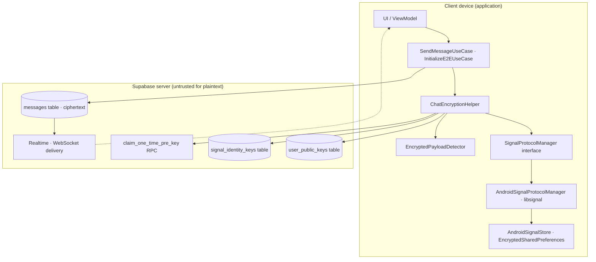

# End-to-End Encryption (E2EE)

Synapse Social implements **Signal Protocol** end-to-end encryption for one-to-one chat messages and group metadata. Encryption happens entirely on the client; the server (Supabase) only stores and transports ciphertext and public key material and never has access to private keys or plaintext.

> **Security stance:** Distinguish implemented properties from recommended improvements. Where a class or method name suggests a security property, this documentation states whether that property is actually enforced in code.

## E2EE document index

| Document | Path | Contents |
|----------|------|----------|
| Architecture | `./architecture.md` | Complete component architecture, Mermaid diagrams, trust boundaries. |
| Key management | `./key-management.md` | Identity keys, signed pre-keys, one-time pre-keys, bundle sync, rotation, identity mismatch. |
| Message encryption | `./message-encryption.md` | Outgoing encryption, incoming decryption, multi-recipient, caching, retry. |
| Security considerations | `./security-considerations.md` | Private-key storage, identity verification, trust-on-first-use, weaknesses, limitations. |

## Technology overview

| Component | Technology | Responsibility |
|-----------|------------|----------------|
| Signal Protocol | [`org.signal:libsignal-android`](https://github.com/signalapp/libsignal) (via `AndroidSignalProtocolManager`) | X3DH session establishment, Double Ratchet encryption/decryption, pre-key store. |
| Local key storage | `androidx.security.crypto` `EncryptedSharedPreferences` + `MasterKey` (Android) via `AndroidSignalStore` | Identity key pair, pre-keys, sessions, sender keys stored at rest, AES-SIV names / AES-GCM values, Keystore-backed master key. |
| Remote public-key storage | Supabase PostgREST tables `user_public_keys` and `signal_identity_keys`, RPC `claim_one_time_pre_key` | Publication and discovery of public key bundles. |
| E2EE orchestration | `ChatEncryptionHelper` (data repository layer) | Session lifecycle, per-message decryption cache, key initialization, identity mismatch handling. |
| Message sending | `SendMessageUseCase` (domain) | Serializes plaintext JSON, fan-out encrypts per recipient, encrypts for sender (multi-device), persists. |
| E2EE initialization | `InitializeE2EUseCase` → `ChatRepository.initializeE2EE()` → `ChatEncryptionHelper.initializeE2EE()` | Key generation, remote bundle upload, identity mismatch resolution. |
| Payload detection | `EncryptedPayloadDetector` (domain util) | Classifies placeholder, single-cipher, and multi-recipient encrypted envelopes. |
| Group metadata E2EE | `GroupMetadataCipher` (data repository) | Fan-out encrypts group name/description/avatar per participant using 1:1 Signal sessions. |

## Important source-code references

- `shared/src/commonMain/kotlin/com/synapse/social/studioasinc/shared/data/crypto/SignalProtocolManager.kt` — Signal Protocol interface.
- `shared/src/androidMain/kotlin/com/synapse/social/studioasinc/shared/data/crypto/AndroidSignalProtocolManager.kt` — Android libsignal implementation.
- `shared/src/androidMain/kotlin/com/synapse/social/studioasinc/shared/data/crypto/store/AndroidSignalStore.kt` — EncryptedSharedPreferences Signal store.
- `shared/src/commonMain/kotlin/com/synapse/social/studioasinc/shared/data/crypto/models/SignalBundle.kt` — `SignalIdentityKeys`, `SignalOneTimePreKey`, `PreKeyBundle`, `EncryptedMessage`.
- `shared/src/commonMain/kotlin/com/synapse/social/studioasinc/shared/data/repository/SignalRepository.kt` — Supabase-backed key bundle fetch (`signal_identity_keys`, `claim_one_time_pre_key`).
- `shared/src/commonMain/kotlin/com/synapse/social/studioasinc/shared/data/repository/ChatEncryptionHelper.kt` — E2EE helper: sessions, decryption cache, initialization, identity mismatch.
- `shared/src/commonMain/kotlin/com/synapse/social/studioasinc/shared/data/datasource/ChatKeyDataSource.kt` — `user_public_keys` table access.
- `shared/src/commonMain/kotlin/com/synapse/social/studioasinc/shared/domain/usecase/chat/SendMessageUseCase.kt` — outgoing message encryption flow.
- `shared/src/commonMain/kotlin/com/synapse/social/studioasinc/shared/domain/usecase/chat/InitializeE2EUseCase.kt` — E2EE initialization use case.
- `shared/src/commonMain/kotlin/com/synapse/social/studioasinc/shared/domain/repository/ChatRepository.kt` — `initializeE2EE()`, `ensureSession()` repository contract.
- `shared/src/commonMain/kotlin/com/synapse/social/studioasinc/shared/domain/util/EncryptedPayloadDetector.kt` — payload classification.
- `shared/src/commonMain/kotlin/com/synapse/social/studioasinc/shared/data/repository/GroupMetadataCipher.kt` — encrypted group metadata fan-out.

## Related feature documentation

- [Chat architecture](../Chat/README.md) — conversations and messaging that E2EE protects.
- [Database architecture](../Database/README.md) — local `CachedMessage` store used for decryption caching.
- [Authentication](../Authentication/README.md) — identity and session on which E2EE key publication depends.

## E2EE architecture at a glance

