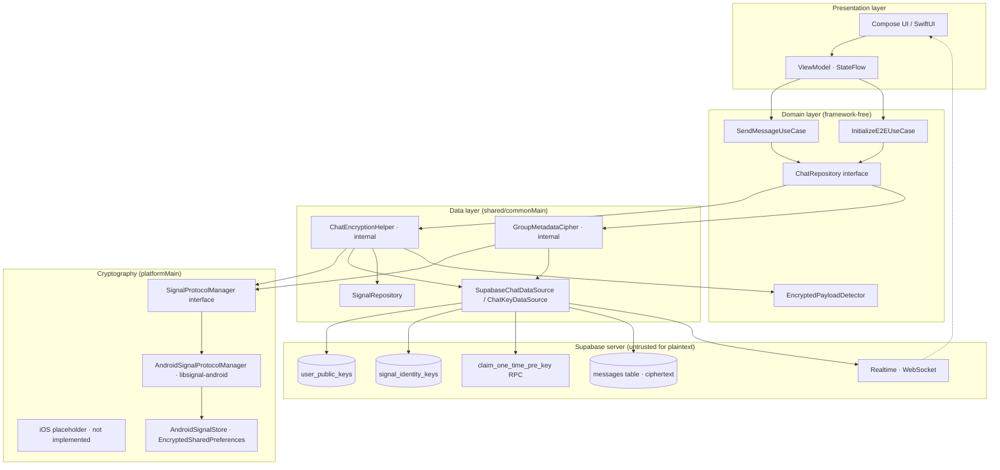
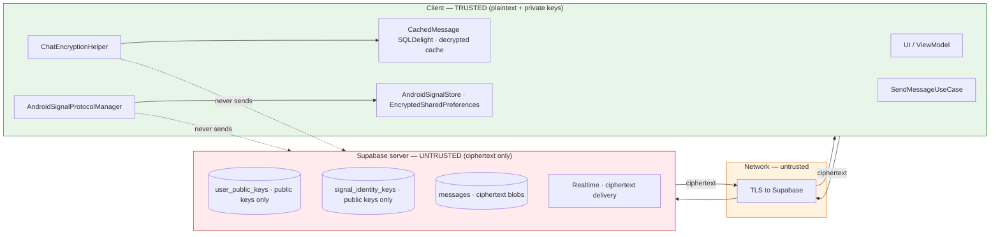
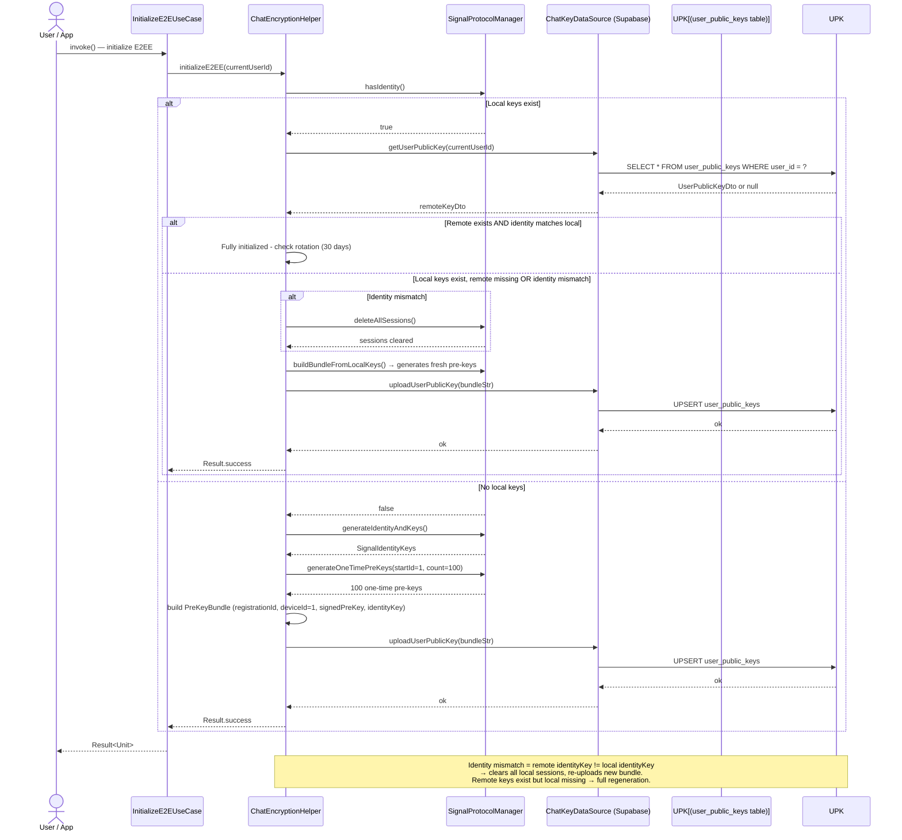
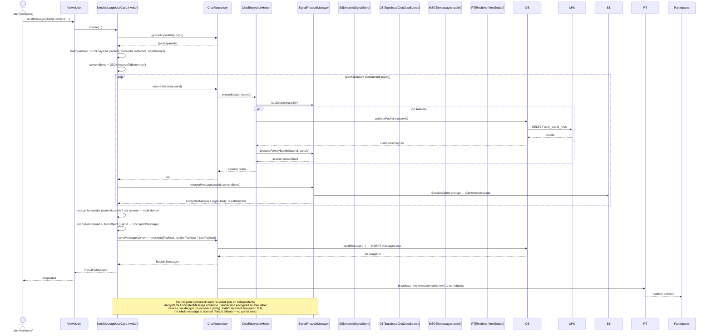
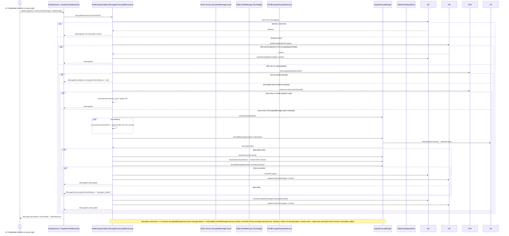
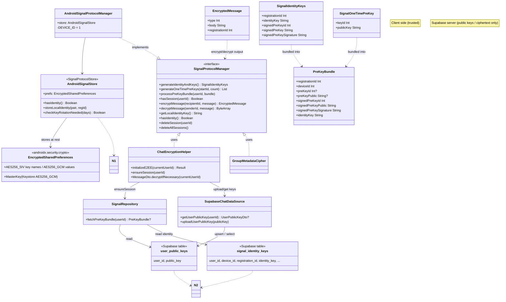

# E2EE Architecture

Complete component architecture for Signal Protocol end-to-end encryption in Synapse Social, including Mermaid diagrams, component responsibilities, and client/server trust boundaries.

## Component architecture

### Responsibilities

| Component | Layer | Responsibility |
|-----------|-------|----------------|
| `SendMessageUseCase` | Domain | Orchestrates outgoing E2EE: serializes plaintext JSON, ensures sessions, fan-out encrypts per recipient, encrypts for sender (multi-device), delegates persistence to `ChatRepository`. |
| `InitializeE2EUseCase` | Domain | Thin wrapper delegating to `ChatRepository.initializeE2EE()`. |
| `ChatRepository` | Domain (interface) | Contract for `initializeE2EE()`, `ensureSession(userId)`, and message send/receive. |
| `EncryptedPayloadDetector` | Domain (util) | Classifies message content as placeholder, single-cipher envelope, or multi-recipient encrypted envelope. |
| `ChatEncryptionHelper` | Data (internal) | Central E2EE orchestration: session lifecycle, decryption with two-tier cache (memory + SQLDelight), key initialization, identity mismatch handling, session-reset retry. |
| `GroupMetadataCipher` | Data (internal) | Fan-out encrypts group name/description/avatar per participant via 1:1 Signal sessions; graceful fallback to plaintext columns. |
| `SignalRepository` | Data | Fetches recipient pre-key bundles from Supabase (`signal_identity_keys`) and claims one-time pre-keys via `claim_one_time_pre_key` RPC. |
| `SupabaseChatDataSource` / `ChatKeyDataSource` | Data | Remote access to `user_public_keys` table (upload/get public key bundle). |
| `SignalProtocolManager` | Data (interface) | Platform-neutral contract: key generation, session establishment, encrypt/decrypt, identity management. |
| `AndroidSignalProtocolManager` | Data (androidMain) | libsignal-android implementation: X3DH, Double Ratchet, pre-key store delegation to `AndroidSignalStore`. |
| `AndroidSignalStore` | Data (androidMain) | `SignalProtocolStore` backed by `EncryptedSharedPreferences`; persists identity, pre-keys, sessions at rest. |

## Client/server trust boundaries

### Trust boundary rules (enforced in code)

1. **Private keys never leave the device.** Identity key pairs and pre-keys are stored only in `AndroidSignalStore` (`EncryptedSharedPreferences`, Keystore-backed master key). `AndroidSignalProtocolManager` never transmits private key material.
2. **Supabase sees only public keys and ciphertext.** The `user_public_keys` and `signal_identity_keys` tables hold public key material. The `messages` table holds encrypted payloads (a map of `userId → EncryptedMessage` plus a sender plaintext copy).
3. **The server cannot decrypt.** Decryption requires the local Double Ratchet session state held in `AndroidSignalStore`. The server never receives session keys.
4. **Domain layer is crypto-agnostic.** UseCases and repository interfaces import no Signal/Supabase types; all crypto is encapsulated in the Data layer.

## Mermaid diagrams

### A. Complete E2EE architecture

The diagram above (component architecture) and the trust-boundary diagram together describe the complete E2EE architecture: client-side cryptographic components, key generation, identity/signed pre-key/one-time pre-key management, public-key publication to Supabase, session establishment, per-recipient encryption, message storage, realtime delivery, decryption, and local caching.

### B. Key initialization sequence

Key initialization scenarios handled (from `initializeE2EE`):

| Scenario | Action |
|----------|--------|
| Local + remote keys, identities match | Already initialized; log key-rotation recommendation if keys older than 30 days. |
| Local keys, remote missing | Re-upload bundle built from local keys (fresh one-time pre-keys). |
| Local keys, remote present, identity mismatch | `deleteAllSessions()`, then re-upload bundle (overwrites remote keys). |
| No local keys (fresh install) | Generate identity + 100 one-time pre-keys, upload bundle. |
| Remote keys exist but local missing | Warn and regenerate everything locally. |

### C. Outgoing message encryption

### D. Incoming message decryption

### E. Key management architecture

## Client/server trust boundaries summary

- **Client-trusted:** UI, ViewModel, UseCases, `ChatEncryptionHelper`, `SignalProtocolManager`, `AndroidSignalStore`, `EncryptedSharedPreferences`, SQLDelight `CachedMessage` decryption cache. Plaintext and private keys exist only here.
- **Server-untrusted:** Supabase `user_public_keys`, `signal_identity_keys`, `messages` (ciphertext), Realtime transport. The server never sees private keys or plaintext.
