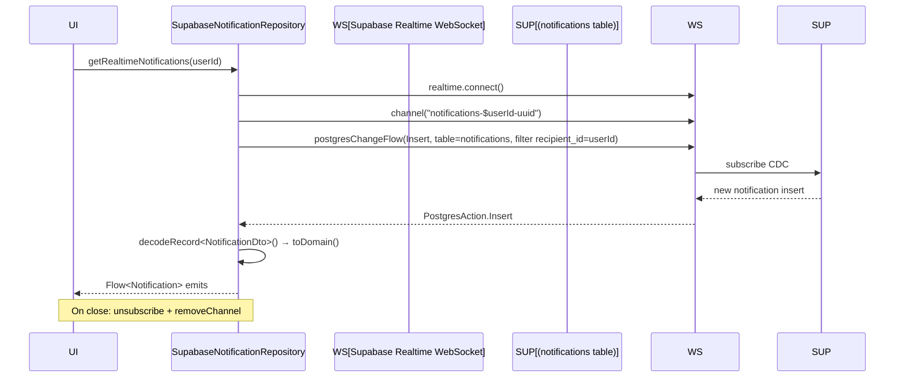

# Notifications Architecture

Notification component architecture: fetching, realtime delivery, preferences, analytics, and OneSignal registration.

```mermaid
flowchart TD
    subgraph UI["Presentation"]
        UI[Notifications screen · preferences]
    end

    subgraph Domain["Domain (framework-free)"]
        NREPO[NotificationRepository interface]
        NMODEL[Notification · NotificationPreferences · NotificationAnalytics]
    end

    subgraph Data["Data layer"]
        SNR[SupabaseNotificationRepository]
    end

    subgraph Server["Supabase"]
        NOTIF[(notifications table)]
        PREFS[(notification_preferences table)]
        ANALYTICS[(notification_analytics table)]
        RT[Realtime · WebSocket CDC]
        USERS[(users · one_signal_player_id)]
    end

    UI --> NREPO
    NREPO --> SNR
    SNR --> NOTIF
    SNR --> PREFS
    SNR --> ANALYTICS
    SNR --> RT
    SNR --> USERS

    style Server fill:#ffebee,stroke:#c62828
    style Data fill:#e8f5e9,stroke:#2e7d32
```

## IDOR protection

All methods validate that the requesting user matches the target `userId` (from `supabase.auth.currentUserOrNull()?.id`):
- `fetchNotifications`, `fetchPreferences`, `updatePreferences`: throw `IllegalStateException` on mismatch (logged as IDOR attempt).
- `markAsRead`, `updateOneSignalPlayerId`: return early on mismatch (logged as IDOR attempt).

## Realtime flow



## Related

- Authentication: [`../Authentication/README.md`](../Authentication/README.md)
- Architecture: [`../Architecture/README.md`](../Architecture/README.md)
