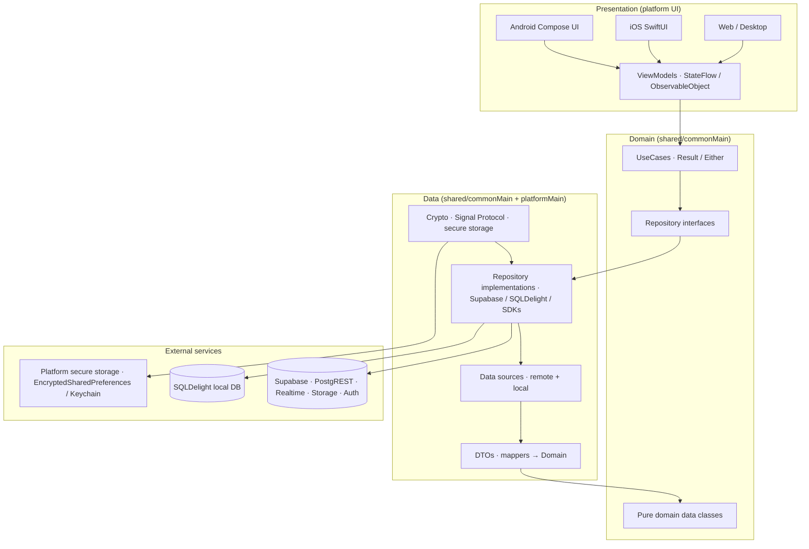

# Synapse Social — Technical Documentation

Synapse Social is a Kotlin Multiplatform (KMP) social messaging application built with **Clean Architecture + MVVM**. This documentation system is the authoritative, interconnected reference for the application's architecture, security design, and feature implementations.

> **Scope note:** This documentation describes the code as implemented in the `shared/`, `app/`, `iosApp/`, `desktop/`, and `web/` modules. It is derived from the actual source code. No application source was modified to produce it.

## Documentation navigation

| Feature | Entry point | Summary |
|---------|-------------|---------|
| [Architecture](./Architecture/README.md) | `./Architecture/README.md` | Project structure, module boundaries, Clean Architecture layers, dependency injection (Koin). |
| [E2EE](./E2EE/README.md) | `./E2EE/README.md` | Signal Protocol end-to-end encryption: keys, sessions, message encryption/decryption, security. |
| [Authentication](./Authentication/README.md) | `./Authentication/README.md` | Supabase Auth flows, session management, OAuth, passkeys (WebAuthn). |
| [Chat](./Chat/README.md) | `./Chat/README.md` | Conversations, messaging, reactions, read receipts, disappearing messages, realtime delivery. |
| [Database](./Database/README.md) | `./Database/README.md` | SQLDelight local database, remote persistence, sync, offline behavior. |
| [Notifications](./Notifications/README.md) | `./Notifications/README.md` | Notification architecture and delivery. |
| [AI](./AI/README.md) | `./AI/README.md` | AI provider integration, smart reply generation. |
| [Voice](./Voice/README.md) | `./Voice/README.md` | Voice message recording, playback, media handling. |
| [Groups](./Groups/README.md) | `./Groups/README.md` | Group creation, membership, roles, invitations, encrypted group metadata. |

## Overall architecture

Synapse follows a strict layering rule: **Presentation → ViewModel → Domain (UseCases / Interfaces) → Data (Repos / DTOs / Mappers)**.

Domain has zero knowledge of any framework, SDK, or platform. The Data layer owns all external concerns (network, storage, SDKs). Presentation is dumb — it renders state and forwards events only.

## How to use this documentation

- Start with [Architecture](./Architecture/README.md) to understand module boundaries and DI.
- Read [E2EE](./E2EE/README.md) for the end-to-end encryption design (highest priority).
- Each feature folder contains a `README.md` entry point plus focused subject documents.
- Documents use relative Markdown links to form a connected knowledge base — prefer internal links over external URLs.

## Source-code conventions referenced

- Domain models: `shared/src/commonMain/kotlin/com/synapse/social/studioasinc/shared/domain/model/`
- UseCases: `.../domain/usecase/`
- Repository interfaces: `.../domain/repository/`
- Repository implementations & data sources: `.../data/repository/` and `.../data/datasource/`
- DTOs & mappers: `.../data/dto/` and `.../data/mapper/`
- SQLDelight schema: `shared/src/commonMain/sqldelight/`
- Platform-specific crypto/storage: `shared/src/androidMain/`, `shared/src/iosMain/`
- DI (Koin): `.../di/`
